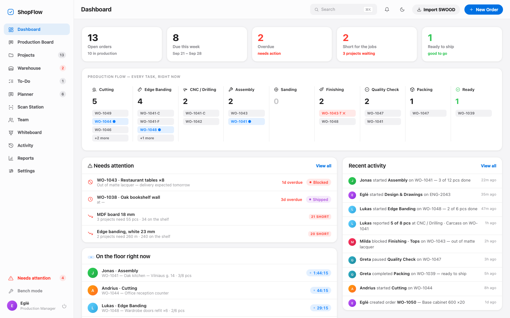

# 🪚 ShopFlow — Production, at a glance

A lightweight **MRPEasy alternative** for small workshops (carpentry, furniture, fabrication).
One glance tells you **where every order is, who's working on it, and what needs attention** —
with the board UX of Monday/Asana/ClickUp and Apple-ecosystem look & feel.

Zero build, zero backend: plain HTML/CSS/JS, saved locally in the browser (`localStorage`).



>  **This is a demo build.** The system it comes from runs daily in a furniture workshop. This
>  version ships only the fictional seed workshop — no customer data, no team PINs, no cloud
>  credentials — and works entirely offline in your browser.

**Live demo:** <https://gervdalius-droid.github.io/shopflow/>
&nbsp;&nbsp;*(demo data — sign in as **Eglė**, PIN **5678** for the manager view, or **Andrius**, PIN **1111** for a worker's station)*
· ~31,000 lines · **1,057 in-browser tests** · offline-first PWA

## Why this exists

We looked at MRPEasy and the rest. They're priced per seat per month, they assume a routing
that's a straight line, and they assume everyone has a computer and reliable internet. A
furniture workshop is none of those things: a cabinet's facades and carcass are made *in
parallel* by different people, the shop floor has one shared tablet, and the wifi drops.

So the model here is built around what actually happens — parallel lanes that merge, pieces
flowing downstream as they finish, PIN sign-in on a shared device, and everything working
with the internet unplugged.

## Deep production model (MRPEasy-style)

- **Articles** — standard products (SKU, unit) with **multi-lane routings**: part groups
  made in parallel (e.g. *Facades*: cut → edgeband → sand → finish; *Carcass*: cut →
  edgeband → CNC) that merge into a final lane (assembly → QC → packing). Ordering
  "Base cabinet 600 ×12" **auto-creates every task** — Cutting appears twice, once per
  part group, and the order sits at several stations at once.
- **Piece tracking** — workers report produced quantity per task (`+`/`−` or Done);
  downstream tasks unlock as upstream pieces become available (min across lanes gates
  assembly). The order row/drawer always answers *how many are done and packed*.
- **Engineering projects** — a separate `ENG-…` type with its own stage flow (Brief →
  Measurement → Design → Client approval → CNC programs → Handoff), switchable scope
  in Projects, its own board columns and dashboard panel.
- **Portfolios** — group orders + engineering projects per client/program with task
  rollups, status pills and due ranges.

## Run it

```bash
cd ~/shopflow && python3 -m http.server 8734
# open http://localhost:8734
```

(Opening `index.html` directly also works in most browsers.)


## Sign in

Apple-TV-style profile picker + **4-digit PIN pad** per team member. PINs are
**never shown on the login screen** and are stored hashed (salt + SHA-256) — no
plaintext in `localStorage` or JSON export. Five wrong tries locks that profile
for 30 s. The demo PINs (documented here, not in the app):

| Who | Role | PIN | Sees |
|---|---|---|---|
| Tomas | Owner / manager | 1234 | Full cockpit |
| Eglė | Production manager | 5678 | Full cockpit |
| Rūta | Engineer (design) | 6789 | Projektavimas only |
| Andrius, Lukas, Jonas, Milda, Greta | Shopfloor workers | 1111…5555 | Worker mode (production only) |

**Security note:** a 4-digit PIN is a 10,000-value space, so this is
shoulder-surf / casual-snoop protection, not strong authentication — fine for a
trusted shop kiosk. The `?as=…` dev auto-login (bypasses the PIN) is honoured
**only on localhost/file://**, never when the app is actually hosted.

## What's inside

**Manager cockpit**
- **Dashboard** — KPI tiles (incl. low stock), a *production flow strip* (live counts per station), needs-attention list (blocked + overdue + low stock), who's on the floor right now with live timers, activity feed.
- **Production Board** — the dedicated full-screen station kanban, one click from the sidebar: drag orders through the flow, live timers, blocked badges, assignee/priority filters.
- **Projects — five switchable views** (ClickUp-style tabs, last-used view remembered per user), including its own Board tab for working inside the hub:
  - **List** — filterable/searchable table with status pills, step-dot progress, station and assignee. **⚙︎ View** menu: group by status/station/priority/client and toggle columns — saved per user.
  - **Board** — Monday-style kanban, one column per station + *Ready to ship*. Drag a card to move an order through the flow (with undo). Live timers, blocked badges, 📉 shortage markers. Filter by assignee/priority, comfortable/compact density, hide empty columns.
  - **Timeline** — Gantt: a bar per order from creation to due date, colored by status with progress fill, weekend shading and today line. **Drag a bar's right edge to reschedule** (audited).
  - **Calendar** — month grid with orders on their due dates. **Drag chips between days to reschedule** (audited), prev/next/today navigation.
  - **Workload** — remaining estimated work per person as stacked bars against an 8-hour day, over-capacity warnings, segments click through to the order.
- Click any order anywhere for the **order drawer**:
  - ✎ edit product/client/qty/unit, due date, priority, notes — **every change logged with author**
  - routing timeline with per-step start/pause/complete/block/assign **plus routing editor** (add/remove/reorder steps)
  - **materials** — link stock items with quantities, live availability, shortage banner, one-tap *Use* (consumes stock)
  - **project files** — one-click *Open project files in OneDrive* (also a cloud shortcut on list rows and board cards). Links resolve from a workshop base folder + project code (auto), or a per-project override URL. Configure the base in Settings → Project files.
  - **history** — the order's full audit trail: what changed, by whom, when
- **Warehouse** — stock list with SKU, quantity/min, shelf location, last movement; low-stock filter + sidebar badge; receive/use with notes; per-item movement ledger; add/edit/delete materials (guarded while open orders need them).
- **Team** — cards with live "working on" status, done-today and queue counts; add/edit members with role, home station and PIN.
- **Scan Station** — a per-machine kiosk (sidebar, or deep-link `?scan=<stationId>` on a dedicated device). A USB/Bluetooth HID scanner types the label code + Enter, or the device camera reads the QR (`BarcodeDetector`); each scan advances that part through the station and updates progress live, with beep + colour feedback and a recent-scans log. Understands SWOOD-style part codes (`SA_GA_VIRT_404` → project `SA_GA_VIRT`), a native `SF|orderId|itemId|part` token, and per-scanner station prefixes (`EDGE#…`). Parts are de-duplicated per station. Configure in Settings → Scan stations.
- **Whiteboard** — FigJam-style shared boards for the whole team (workers get an *Ideas* tab):
  pan/zoom canvas, sticky notes (7 colors), text, workflow shapes with arrow connectors,
  editable tables, freehand pen. Double-click empty space for a sticky; V/S/T/R/C/B/P
  shortcuts; every element shows who added it and when; boards live-sync between open tabs.
- **Activity** — the full audit log, grouped by day, filterable by person, searchable; entries link straight to the order/material.
- **Settings → Workflow stations** — rename, re-icon, reorder, add or delete the stations every order flows through.
- **New order** — product/client/qty/due/priority + routing picker with per-station time estimates.
- **⌘K** command palette (orders, people, materials), light/dark/auto theme, JSON export, demo-data reset.

**Worker mode** (tablet-friendly, big targets)
- **My Work** — one giant hero card for the running job with live timer and Pause / Problem / **Done**; "Up next" queue sorted by priority & due date.
- **Stations** — queue per station; claim any unclaimed job with one tap.
- **Flow** — read-only view of the whole shop.
- Starting a job auto-pauses your previous one; completing advances the order to the next station.

## Handy URL params

`?as=manager` / `?as=Jonas` (auto sign-in) · `?view=projects&tab=timeline|calendar|workload|board|list` · `?order=WO-1043` · `?theme=dark`

## Tests

`http://localhost:8734/test.html` — 46 in-browser assertions over the domain logic
(status derivation, timers, drag-move semantics, PIN login, warehouse stock flows,
routing/station editing, audit logging, view prefs, v1→v2 migration, the five
project views, calendar navigation, timeline ranges, rendering).

## Files

| File | What |
|---|---|
| `index.html` | Shell |
| `styles.css` | Design system (SF typography, translucent surfaces, light/dark) |
| `data.js` | Store + seed data + domain logic (`D`) + mutations (`M`) |
| `app.js` | Session, PIN login, router, toasts, modals, drawer, ⌘K palette |
| `manager.js` | Dashboard, board, orders, team, settings, order drawer, new order |
| `worker.js` | Shopfloor mode |
